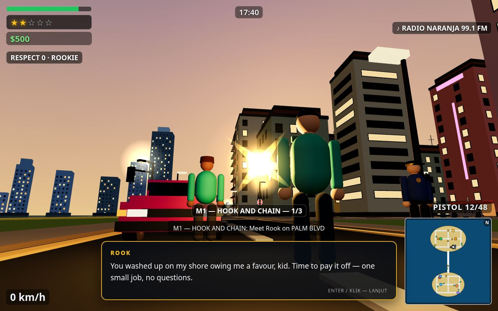
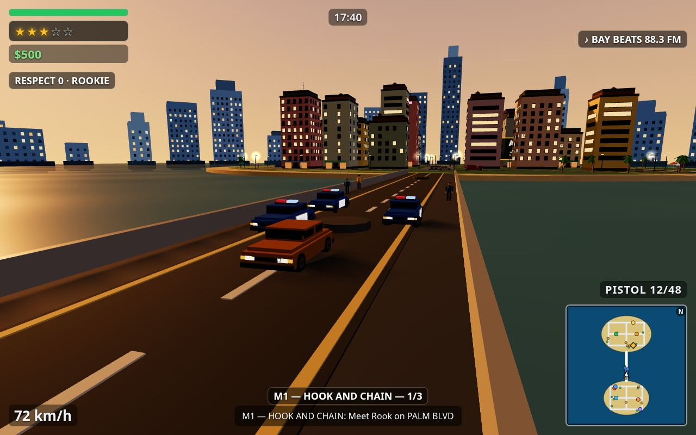
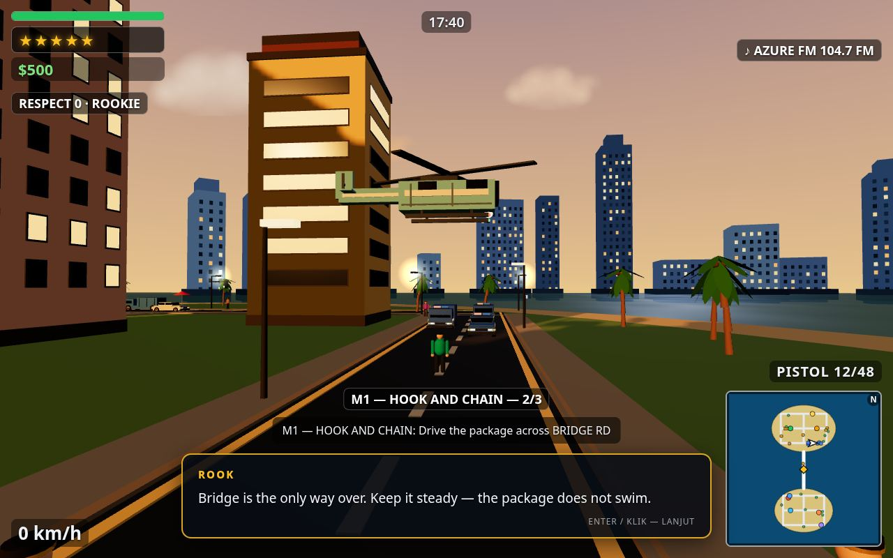
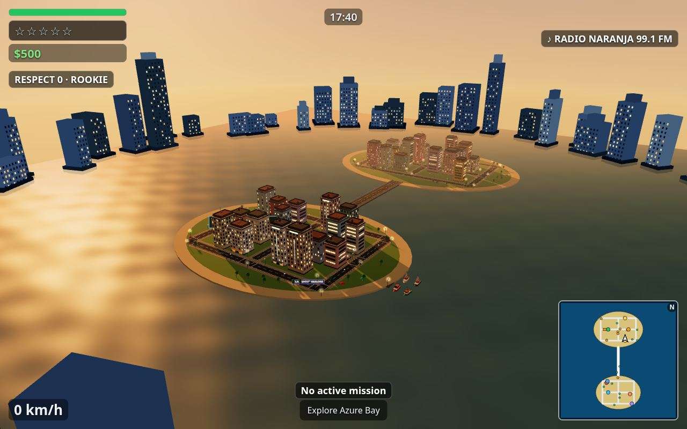

[](https://make.fun/competitions/gta6-01)
[](https://make.fun/competitions/gta6-01/leaderboard)
[](https://make.fun/competitions/gta6-01)

# AZURE BAY — gta6-01

A sun-soaked, two-island coastal city joined by a bridge — an open-world crime game on vendored Three.js r160. Start as a $500 nobody, take jobs, steal cars, and climb to Bay King across 10 story missions in 4 chapters.

## The city

- Two islands (north 220×160 m, south 200×150 m) joined by a 14 m bridge, 13 road segments, 34 buildings, ~36 palms, and a marina with 4 boats.
- Golden-hour lighting, warm fog, a sky shader with a sun disc, lit windows, neon storefronts, street names (OCEAN AVE, PALM BLVD, BRIDGE RD, BAY ST, CORAL WAY, MARINA DR), and a distant skyline.
- Traffic: 8 AI cars, 12 pedestrians, police patrols, and a helicopter at 5-star wanted.

## The story — 10 missions, 4 chapters

- **CH.1 LOW TIDE (M1–M5):** in debt to Rook the fixer — reclaim the ledger.
- **CH.2 RISING TIDE (M6–M7):** the Kingfish moves in.
- **CH.3 HIGH WATER (M8–M9):** open war on the bay.
- **CH.4 STORM SURGE (M10):** the finale — wanted 5, helicopter overhead.

Five NPCs: Rook, Eddie "Wrench" Kowalski, Silas "Ghost" Marlowe, Dante "Kingfish" Moreau, and Det. Ray Calloway. Missions pay $400–$2,500 and build Respect (ROOKIE → HUSTLER → RESPECTED → BAY KING).

## Systems

- **Safehouse:** ODALYS'S GARAGE — heal to full, save the game, swap weapons on the rack.
- **Shops:** AZURE ARMORY (pistol, SMG, ammo, medkits) and BAY CUSTOMS (repair, armor, engine upgrades).
- **Radio:** RADIO NARANJA 99.1, AZURE FM 104.7, BAY BEATS 88.3 — press R in a car.
- **Save / load:** localStorage full saves plus mission checkpoints, so a death mid-mission respawns at the current stage instead of the start.
- **Combat:** fists, pistol, SMG; wanted stars, police cars, and a helicopter hunt you down.
- **HUD:** responsive at any window size — the layout scales and re-flows instead of overlapping at 800×500.

## Play

```sh
node serve.ts   # then open http://localhost:8080
```

`main.ts` is the competition entrypoint (Node 22, standard library only — no Deno APIs): it copies `game/` and `screenshots/` to the output directory and writes `dossier.json`.

## Controls

- **WASD / arrows** — walk / drive · **Shift** — run · **Mouse** — look (pointer lock)
- **E** — enter/exit car, interact · **M** — mission menu · **R** — switch radio station (in car) / reload (on foot) · **1 / 2 / 3** — weapons

## Screenshots






## License

MIT — see [LICENSE](LICENSE).
